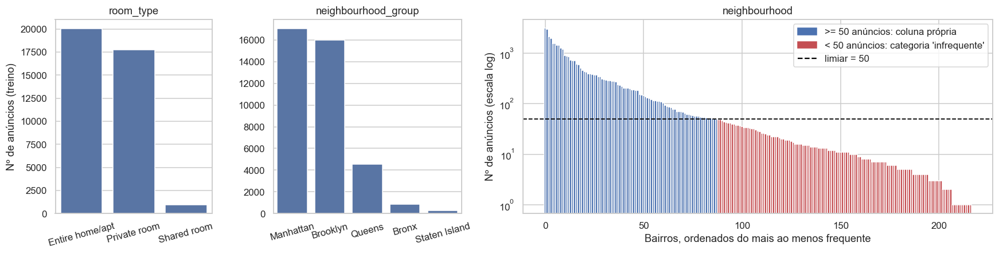

# APS2 — Regressão do preço de anúncios em NYC

**Objetivo:** prever o preço por noite (`price`, em US$) de anúncios do Airbnb em Nova York. A página segue a mesma
estrutura do notebook `nycairbnb.ipynb` e do roteiro da APS2. As 14 figuras são os PNGs salvos nas saídas do notebook,
exportados sem redesenho, com a mesma numeração. Cada figura é seguida da sua análise, e cada decisão cita a figura que a
motivou.

| Seção | Item do roteiro |
|---|---|
| [0](#0-dados-e-pipeline-de-pre-processamento) | Dados e pipeline de pré-processamento |
| [1.1 – 1.4](#1-selecao-e-implementacao-dos-modelos) | 3 modelos e métrica · hiperparâmetros · mudança no pipeline e impacto · curvas de aprendizado |
| [2](#2-avaliacao-do-melhor-modelo-no-conjunto-de-teste) | Avaliação do melhor modelo no teste |
| [3.1 – 3.4](#3-interpretacao-e-explicabilidade) | Coeficientes do linear · importância no ensemble · SHAP global · SHAP em 3 predições |
| [4.1 – 4.3](#4-discussao-critica) | Limitações do modelo · limitações dos dados · operacionalização e manutenção |

## 0. Dados e pipeline de pré-processamento

Ordem adotada: carregar → aplicar apenas regras **estruturais** → **separar treino e teste** → só então inspecionar,
gerar figuras e decidir o pré-processamento, **usando apenas o treino**. Nenhuma estatística do teste influencia as
decisões.

### 0.1 Regras estruturais e separação treino/teste

- **`price <= 0`** (11 anúncios): diária zero não é um preço válido; é uma regra de validade, não um corte baseado em
  distribuição.
- **Colunas removidas:** `id` e `host_id` (identificadores), `name` e `host_name` (texto livre, exigiria NLP) e
  `last_review` (data; volume e frequência de avaliações permanecem em `number_of_reviews` e `reviews_per_month`).
- **Split 80/20** com `random_state=42`, antes de qualquer inspeção: 39.107 anúncios no treino e 9.777 no teste.

### 0.2 Inspeção do treino e evidências para o pré-processamento

O `describe()` é aplicado **somente ao alvo** (numérico) e **somente no treino**: mediana de US$ 106, percentil 90 de
US$ 269, percentil 99 de US$ 798,76, máximo de US$ 10.000 e assimetria de 19,7. As variáveis categóricas são inspecionadas
por contagem de frequências (Figura 2).

<figure markdown>
  
  <figcaption>Figura 1 — Distribuição do preço no treino (eixo em escala log). Linhas: mediana (verde) e percentil 99 (vermelho).</figcaption>
</figure>

**Análise da Figura 1.** Mesmo em escala log, a distribuição tem cauda longa à direita. No boxplot, os pontos acima do
p99 formam uma cauda rarefeita que se estende por mais de uma ordem de grandeza, até US$ 10.000. Esses **392 anúncios
(1,0% do treino) respondem por 83% da soma dos desvios quadráticos** do preço: num modelo avaliado por RMSE, eles
dominariam o ajuste e a métrica.
→ **Decisão:** limitar o alvo ao **p99 do treino (US$ 798,76)** e aplicar o mesmo limite ao teste (392 anúncios removidos
do treino e 100 do teste; restam 38.715 e 9.677). O escopo do modelo passa a ser anúncios de até ~US$ 800/noite, e as
métricas valem para esse recorte. A mesma figura também motiva a mudança testada na [seção 1.3](#13-mudanca-no-pipeline-transformacao-logaritmica-do-alvo).

<figure markdown>
  
  <figcaption>Figura 2 — Frequência das variáveis categóricas no treino. No painel de bairros (escala log), azul indica coluna própria no OHE e vermelho, agrupamento como "infrequente".</figcaption>
</figure>

**Análise da Figura 2.**

- `room_type` tem 3 categorias, com `Shared room` bem menos frequente (~2% do treino); `neighbourhood_group` tem 5
  distritos, concentrados em Manhattan e Brooklyn, com Bronx e Staten Island pequenos mas ainda com centenas de anúncios.
  Todas são **nominais e com 3 ou mais categorias** → **One-Hot Encoding**. Não há variáveis binárias, então o OHE não gera
  colunas redundantes.
- `neighbourhood` tem 217 bairros com frequência muito desigual: há uma cauda de **129 bairros com menos de 50 anúncios**
  (mediana de 11) que somam só 4,8% do treino. Coeficientes estimados com 1 a 10 anúncios seriam instáveis.
  → **Decisão:** `OneHotEncoder(min_frequency=50)`: 88 bairros ganham coluna própria e os demais viram "infrequente". A
  localização fina desses anúncios continua disponível em `latitude` e `longitude`.

**Valores ausentes.** No treino, só `reviews_per_month` tem ausentes (8.012), e eles coincidem exatamente com
`number_of_reviews == 0` → **Decisão:** imputar **0**, e não a média. As demais numéricas não têm ausentes; o imputador
pela mediana é preventivo para dados novos.

### 0.3 Pipeline

| Evidência | Decisão no pipeline |
|---|---|
| Ausência de `reviews_per_month` ⇔ zero reviews | `SimpleImputer(constant=0)` nessa coluna |
| Numéricas em escalas muito diferentes | `StandardScaler`, para que a penalização L2 do Ridge trate todas na mesma escala |
| Figura 2: categóricas nominais, sem binárias | `OneHotEncoder` |
| Figura 2: 129 bairros com < 50 anúncios | `min_frequency=50` |
| Figura 1: cauda extrema do preço | Corte no p99 do treino |

Não usamos **PCA**: há apenas 7 numéricas, e a seção 3 exige interpretar coeficientes e importâncias por feature original.
Tudo fica em `Pipeline` + `ColumnTransformer`, reajustado em cada fold (sem vazamento), o que resulta em **104 features**.
O HistGradientBoosting usa `early_stopping=False`: por padrão, a parada antecipada liga sozinha acima de 10 mil linhas, o
que faria o `max_iter` tunado ser ignorado e mudaria o regime de ajuste no meio da curva de aprendizado
([documentação](https://scikit-learn.org/stable/modules/generated/sklearn.ensemble.HistGradientBoostingRegressor.html)).

## 1. Seleção e implementação dos modelos

### 1.1 Três modelos e a métrica de desempenho

- **Dummy** (`DummyRegressor`, média do treino): linha de base.
- **Linear com regularização** (`Ridge`, L2): simples e interpretável. A regularização controla os coeficientes de
  colunas one-hot correlacionadas (bairro × distrito × coordenadas).
- **Ensemble de árvores** (`HistGradientBoostingRegressor`): captura não-linearidades e interações.

**Métrica:** **RMSE** em US$: mesma unidade do preço e penaliza mais os erros grandes. MAE e R² são de apoio; **todas as
decisões usam o RMSE**. **Validação:** `KFold(n_splits=5, shuffle=True, random_state=42)` em todas as etapas, só no treino.

| Modelo padrão | RMSE (CV), US$ | Desvio entre folds | MAE (CV), US$ | R² (CV) |
|---|---:|---:|---:|---:|
| Dummy (média) | 103,12 | 2,43 | 73,18 | −0,00 |
| Ridge (`alpha=1`) | 79,66 | 2,15 | 49,83 | 0,40 |
| HistGB padrão | 72,82 | 1,77 | 44,42 | 0,50 |

O Ridge já reduz o erro em ~23% frente ao Dummy, o que mostra sinal linear relevante. O ganho extra do ensemble indica
não-linearidades e interações que o modelo linear não representa.

### 1.2 Seleção de hiperparâmetros

- **Ridge → `GridSearchCV`**: um único hiperparâmetro (`alpha`), com grade log de 10⁻⁴ a 10⁴ (17 valores).
- **HistGB → `RandomizedSearchCV`** (15 candidatos): cinco hiperparâmetros que interagem; a busca aleatória explora o
  espaço com muito menos ajustes que uma grade completa.

<figure markdown>
  
  <figcaption>Figura 3 — Curva de validação do Ridge (± 1 desvio entre folds). O círculo marca o alpha escolhido.</figcaption>
</figure>

**Análise da Figura 3.** O RMSE é praticamente constante (US$ 79,66) de `alpha = 10⁻⁴` até `≈ 10` e só piora com
penalização forte (US$ 85,7 em 10⁴). As barras de erro (~US$ 2) são muito maiores que as diferenças dentro do platô.
O `alpha = 1` está no platô, não na borda da grade. Com ~39 mil linhas para 104 colunas, a regularização não melhora a
generalização; ela só estabiliza coeficientes de colunas correlacionadas.

| Hiperparâmetro do HistGB | Espaço da busca | Melhor valor |
|---|---|---:|
| `learning_rate` | Loguniforme 0,02 – 0,3 | 0,04843 |
| `max_iter` | Inteiros 150 – 599 | 364 |
| `max_leaf_nodes` | Inteiros 15 – 79 | 76 |
| `min_samples_leaf` | Inteiros 10 – 99 | 49 |
| `l2_regularization` | Loguniforme 0,001 – 10 | 0,8111 |

O ajuste reduz o RMSE do HistGB de US$ 72,82 para **US$ 72,47**, um ganho pequeno frente ao desvio entre folds (~US$ 1,8).
**Conclusão parcial:** o HistGB tunado é o melhor modelo até aqui (−29,7% de RMSE frente ao Dummy). Como o tuning rendeu
pouco nos dois modelos, o limite parece estar mais nas features do que nos hiperparâmetros.

### 1.3 Mudança no pipeline: transformação logarítmica do alvo

**Proposta.** A Figura 1 mostrou forte assimetria do preço, e os efeitos tendem a ser multiplicativos. Modelar
`log(1 + price)` deixa o alvo mais simétrico e reduz o peso dos anúncios caros. **Implementação:**
`TransformedTargetRegressor(func=np.log1p, inverse_func=np.expm1)` envolvendo o pipeline. As previsões voltam para US$
antes da métrica, então o RMSE continua comparável. **As buscas são refeitas** para os dois modelos, com o mesmo espaço,
orçamento, métrica e folds.

<figure markdown>
  
  <figcaption>Figura 4 — Alvo de treino (após o corte no p99) antes e depois de log1p.</figcaption>
</figure>

**Análise da Figura 4.** O log reduz a assimetria do alvo de 2,2 para 0,2: a cauda longa vira uma distribuição próxima de
simétrica. A transformação faz o que se propunha *no alvo*; se ela melhora a *métrica*, a validação cruzada responde.

<figure markdown>
  
  <figcaption>Figura 5 — Comparação final na validação cruzada. As barras de erro são um desvio padrão entre folds.</figcaption>
</figure>

| Modelo | RMSE (CV), US$ | Desvio | MAE (CV), US$ | R² (CV) |
|---|---:|---:|---:|---:|
| Ridge tunado | 79,66 | 2,15 | 49,83 | 0,40 |
| HistGB tunado | **72,47** | 1,82 | 44,09 | 0,51 |
| Ridge tunado com log | 80,54 | 2,39 | 46,20 | 0,39 |
| HistGB tunado com log | 73,22 | 2,09 | **41,84** | 0,50 |

**Análise da Figura 5 e impacto da mudança.** Com o log, o **MAE cai** ~5% (HistGB) e ~7% (Ridge), mas o **RMSE sobe**
~US$ 0,8 a 0,9 nos dois modelos. Em log, o modelo minimiza o erro quadrático *relativo*, e `expm1` da previsão estima algo
próximo da **mediana** condicional, não da **média** (Duan, 1983). Numa distribuição assimétrica, isso subestima os
anúncios caros, onde o erro quadrático mais pesa. O MAE melhora porque o modelo acerta melhor a massa de anúncios
baratos. No Ridge com log, o melhor `alpha` ficou em 10⁻⁴, mas o RMSE varia só US$ 0,07 entre 10⁻⁴ e 10: é o mesmo platô
da Figura 3.
**Decisão:** pela métrica escolhida (RMSE), a mudança é **rejeitada** e o melhor modelo segue sendo o **HistGB tunado com
alvo original**. Se o objetivo fosse MAE ou erro percentual, o log seria a escolha.

### 1.4 Curvas de aprendizado do melhor modelo

<figure markdown>
  
  <figcaption>Figura 6 — learning_curve do HistGB tunado, mesmos 5 folds, 6 tamanhos de treino. Faixas: ± 1 desvio entre folds.</figcaption>
</figure>

| Exemplos de treino | 3.097 | 8.672 | 14.247 | 19.822 | 25.397 | 30.972 |
|---|---:|---:|---:|---:|---:|---:|
| RMSE treino, US$ | 44,41 | 47,58 | 52,76 | 55,81 | 58,08 | 59,71 |
| RMSE validação, US$ | 79,61 | 76,43 | 74,65 | 73,71 | 72,93 | 72,47 |
| Gap, US$ | 35,20 | 28,85 | 21,88 | 17,90 | 14,85 | 12,76 |

**Análise da Figura 6.**

- Com ~3 mil exemplos, o gap é de US$ 35: com 76 folhas e 364 iterações, o modelo memoriza boa parte de uma amostra
  pequena (alta variância).
- Com mais dados, o erro de treino **sobe** e o de validação **cai**; o gap encolhe continuamente até **US$ 12,8**.
- A validação ainda desce no final, mas cada vez menos: **mais dados do mesmo tipo trariam ganho pequeno**, e o gap
  remanescente indica alguma variância.
- As curvas convergem para um patamar alto, sinal de **viés**: uma melhora relevante exigiria informação nova sobre o
  imóvel, não só mais linhas.

## 2. Avaliação do melhor modelo no conjunto de teste

O HistGB tunado, reajustado em todo o treino, é avaliado **uma única vez** nos 9.677 anúncios do teste (mesmo recorte de
preço), que não participaram de nenhuma decisão anterior.

| Métrica | HistGB tunado | Dummy |
|---|---:|---:|
| RMSE, US$ | **72,67** | 102,50 |
| MAE, US$ | 44,31 | — |
| R² | 0,50 | — |

O RMSE no teste (US$ 72,67) confirma a estimativa da CV (US$ 72,47). O modelo reduz o RMSE em **29%** frente ao Dummy e
explica ~50% da variância do preço.

<figure markdown>
  
  <figcaption>Figura 7 — Diagnósticos de regressão no teste. Resíduo = real − predito; positivo = subestimação.</figcaption>
</figure>

**Análise da Figura 7.**

- **(a) Real vs. predito:** até ~US$ 250 os pontos acompanham a diagonal; acima disso ficam quase todos **abaixo** dela.
  O modelo raramente prevê mais de US$ 400 e "comprime" as previsões em direção à média. As colunas verticais em US$ 100,
  150, 200, 250, 300 e 500 são preços redondos.
- **(b) Resíduos vs. predito:** para previsões baixas, os resíduos são pequenos e levemente negativos. Entre US$ 100 e 300,
  aparecem resíduos positivos de até +US$ 600: a variância do erro cresce com o preço (heterocedasticidade). As listras
  diagonais vêm dos preços redondos: para um preço real fixo, o resíduo cai linearmente com a previsão.
- **(c) Distribuição dos resíduos:** pico estreito perto de zero, média ≈ US$ 0,1, mas **mediana de −US$ 9,4** e
  assimetria de 2,5. Na maioria dos anúncios, o modelo superestima um pouco; numa minoria, subestima muito. 9,9% dos
  anúncios têm erro acima de US$ 100.

| Faixa de preço real, US$ | Anúncios | MAE, US$ | Resíduo médio, US$ |
|---|---:|---:|---:|
| (0; 75] | 3.082 | 21,9 | −19,1 |
| (75; 150] | 3.692 | 36,1 | −21,5 |
| (150; 250] | 1.940 | 46,3 | 5,1 |
| (250; 400] | 712 | 100,0 | 87,5 |
| (400; 798,76] | 251 | 268,0 | 267,2 |

Até US$ 150 há superestimação média de ~US$ 20; acima de US$ 400 a subestimação média chega a **US$ 267**. O erro
agregado esconde que o modelo é bom para o mercado de massa e fraco para os anúncios caros.

## 3. Interpretação e explicabilidade

### 3.1 Modelo linear: 3 maiores coeficientes em magnitude

Ridge tunado com alvo original (coeficientes em US$). Numéricas padronizadas: o coeficiente é a variação para +1 desvio
padrão. Colunas one-hot: contribuição de pertencer à categoria, mantidas as demais.

<figure markdown>
  
  <figcaption>Figura 8 — 15 maiores coeficientes do Ridge em magnitude (US$).</figcaption>
</figure>

**Análise da Figura 8.**

1. **`neighbourhood_Tribeca` (+US$ 103):** com as demais features fixas, Tribeca está associado a ~US$ 100 a mais na diária.
   É um dos bairros mais caros de Manhattan.
2. **`neighbourhood_NoHo` (+US$ 82):** bairro pequeno e valorizado de Manhattan; o modelo usa informação de bairro **além**
   do distrito e das coordenadas.
3. **`room_type_Entire home/apt` (+US$ 68):** o fator mais forte fora da localização. Com `Shared room` em −US$ 47, o
   contraste entre imóvel inteiro e quarto compartilhado é de ~US$ 115.

Entre os negativos, Inwood (−US$ 64), Washington Heights (−US$ 60) e Staten Island (−US$ 48) mostram que "estar em
Manhattan" não basta. As 15 barras são indicadores de bairro, distrito ou tipo de quarto, e nenhuma numérica aparece, o
que é coerente com efeitos de localização que não são lineares nas coordenadas. **Cuidados:** o OHE mantém todas as
categorias (sem referência omitida), então comparações fazem mais sentido dentro de um mesmo bloco; bairro, distrito e
coordenadas são redundantes; e são associações, não efeitos causais.

### 3.2 Ensemble: 3 features de maior importância

O HistGB não tem `feature_importances_`; usamos **importância por permutação** em 3.000 anúncios do teste (5 repetições,
mesmo RMSE), embaralhando uma coluna **original** por vez.

<figure markdown>
  
  <figcaption>Figura 9 — Importância por permutação do HistGB tunado (± desvio entre repetições).</figcaption>
</figure>

**Análise da Figura 9.**

1. **`room_type` (+US$ 30,7):** quase 3× a segunda; em linha com o Ridge.
2. **`longitude` (+US$ 11,4):** com `latitude` (5ª, +US$ 7,9), representa a localização. O ensemble usa as **coordenadas
   contínuas**, enquanto o Ridge se apoia nos indicadores de bairro.
3. **`minimum_nights` (+US$ 10,6):** não aparecia entre os maiores coeficientes do Ridge, o que sugere um efeito não linear
   capturado pelas árvores. A direção aparece na seção 3.3.

`availability_365` (+US$ 10,0) fica muito próxima da 3ª posição: diferenças de ~US$ 1 entre as posições 2 a 4 não tornam a
ordem robusta. `neighbourhood` e `neighbourhood_group` ficam baixos porque sua informação já está nas coordenadas, e a
permutação subestima features correlacionadas.

### 3.3 SHAP: importância global

`TreeExplainer` (Lundberg; Lee, 2017) sobre 1.500 anúncios do teste pré-processados. Valores SHAP em **US$**: valor base
(~US$ 137) + contribuições = previsão.

<figure markdown>
  
  <figcaption>Figura 10 — Média de |SHAP| por feature (magnitude, sem direção).</figcaption>
</figure>

**Análise da Figura 10.** O ranking confirma a permutação: **`room_type_Entire home/apt` (US$ 51)**, **`longitude`
(US$ 20)**, **`availability_365` (US$ 16)**, **`latitude` (US$ 13)** e **`minimum_nights` (US$ 10)**.

<figure markdown>
  
  <figcaption>Figura 11 — Beeswarm: cada ponto é um anúncio; vermelho = valor alto da feature, azul = baixo.</figcaption>
</figure>

**Análise da Figura 11.**

- **Imóvel inteiro:** dois blocos, em ~+US$ 50 (sim) e ~−US$ 50 (não).
- **`longitude`:** valores altos (leste: Queens e Brooklyn mais distante) reduzem; valores baixos (Manhattan e o Brooklyn
  ribeirinho) aumentam.
- **`availability_365`:** alta disponibilidade aumenta, até +US$ 90.
- **`latitude`:** latitudes baixas (sul do Brooklyn, Staten Island) reduzem; as faixas intermediárias (Manhattan)
  aumentam. É um efeito não monotônico.
- **`minimum_nights`:** estadias mínimas longas reduzem até −US$ 90; valores baixos ficam perto de zero.
- `neighbourhood_Midtown` é zero para quase todos, mas soma até +US$ 130 quando ativo.

A ordem difere um pouco da permutação porque o SHAP mede quanto a feature **move a previsão**, e a permutação, quanto o
**erro piora**.

### 3.4 SHAP: três predições individuais

Menor, mediano e maior preço predito na amostra SHAP; valor base de US$ 137,4.

<figure markdown>
  
  <figcaption>Figura 12 — Menor previsão: quarto compartilhado em Bay Ridge, Brooklyn. Real US$ 24; previsto US$ 25.</figcaption>
</figure>

As maiores contribuições são **não ser imóvel inteiro (−US$ 49)** e **latitude (−US$ 35)**: Bay Ridge fica no extremo sul do
Brooklyn. Estadia mínima de 10 noites (−US$ 10) e disponibilidade zero (−US$ 9) também reduzem. A longitude soma +US$ 15
(Bay Ridge fica no lado oeste do Brooklyn). O acerto é quase exato.

<figure markdown>
  
  <figcaption>Figura 13 — Previsão mediana: quarto privado em Hell's Kitchen, Manhattan. Real US$ 350; previsto US$ 123.</figcaption>
</figure>

A localização puxa para cima (**longitude +US$ 26, latitude +US$ 21**), mas **não ser imóvel inteiro (−US$ 56)** e
**disponibilidade zero (−US$ 18)** dominam. O modelo **subestima em US$ 227**: um quarto privado com uma avaliação e sem
disponibilidade parece um anúncio comum de ~US$ 120, e nada nas features justifica US$ 350. É um exemplo concreto da cauda
direita da Figura 7(c).

<figure markdown>
  
  <figcaption>Figura 14 — Maior previsão: quarto privado em Midtown, Manhattan. Real US$ 499; previsto US$ 545.</figcaption>
</figure>

Mesmo sendo quarto privado (**−US$ 30**), a previsão passa de US$ 500 por uma combinação rara: **Midtown (+US$ 132)**,
**disponível o ano todo (+US$ 91)**, **anfitrião com 12 anúncios (+US$ 73)** e **longitude (+US$ 65)**. O padrão é
compatível com uma operação comercial, mas os dados não confirmam isso. O modelo superestima em US$ 46.

Os três casos mostram o que a importância global não mostra: a feature dominante pode ser **superada** por uma combinação
de outras (caso 3), e um erro grande pode vir da **ausência** de informação que diferencie o anúncio (caso 2).

## 4. Discussão crítica

### 4.1 Duas limitações do melhor modelo

1. **Não informa a incerteza da previsão.** A seção 2 mostrou que o erro típico vai de ~US$ 20 nos anúncios baratos a
   mais de US$ 250 nos caros, mas o modelo devolve um único valor. Alternativas: **regressão quantílica**
   (Koenker; Bassett, 1978), disponível em `HistGradientBoostingRegressor(loss="quantile")`, ou **predição conformal**
   (Lei et al., 2018), com cobertura marginal garantida sob permutabilidade.
2. **A validação aleatória pode ser otimista para anúncios realmente novos.** Anúncios do mesmo prédio ou anfitrião caem
   ao mesmo tempo em treino e validação. Roberts et al. (2017) mostram que, com dados espacial ou hierarquicamente
   agrupados, a validação aleatória subestima o erro, e Kaufman et al. (2012) tratam esse compartilhamento como
   vazamento. `GroupKFold` por `host_id` ou blocos espaciais dariam uma estimativa mais honesta.

### 4.2 Duas limitações dos dados

1. **O alvo é o preço pedido, não o preço de mercado.** `price` é o valor cadastrado pelo anfitrião no dia da coleta, sem
   saber se houve reserva, descontos, taxas ou variação por data. Gibbs et al. (2018) encontraram diferenças sistemáticas
   de preço entre anfitriões profissionais e ocasionais para imóveis comparáveis. Parte do erro é ruído do próprio alvo,
   que nenhum modelo elimina.
2. **É um retrato de 2019, de um mercado que mudou.** Os dados são anteriores à pandemia e à *Local Law 18* de NYC
   (Nova York, 2022), fiscalizada desde setembro de 2023, que exige registro do anfitrião e reduziu drasticamente as
   estadias com menos de 30 noites. As relações aprendidas provavelmente mudaram (*concept drift*; Gama et al., 2014).
   Além disso, `availability_365 = 0` pode significar "sempre reservado" ou "anúncio inativo", e o modelo não distingue
   os dois casos.

### 4.3 Duas ações para operacionalização e manutenção

1. **Empacotar o pipeline completo e validar as entradas.** Serializar pré-processamento + modelo num único artefato
   versionado (com versões das bibliotecas, esquema e recorte de preço) e servi-lo por uma API. Validar tipos, faixas
   plausíveis e categorias novas antes de prever, registrando bairros desconhecidos. Esses testes seguem Breck et al.
   (2017) e reduzem a dívida técnica descrita por Sculley et al. (2015).
2. **Monitorar *drift* e retreinar com critério.** Acompanhar a distribuição das entradas e, quando houver preços
   observados, o RMSE/MAE **por faixa de preço** (o erro agregado esconde a faixa cara). Definir gatilhos de retreino e
   comparar o candidato com o modelo vigente em dados separados (*champion–challenger*), como nas estratégias de
   adaptação a *concept drift* de Gama et al. (2014).

As referências completas estão em [Referências](references.md).
