# Análise e Modelagem

## Objetivo

Estimar o preço anunciado por noite (`price`, em dólares) de anúncios de Airbnb em Nova York. O notebook compara modelos com diferentes níveis de complexidade e usa o RMSE como critério principal de seleção.

## 1. Inspeção e Preparação

O CSV original tem 48.895 linhas e 16 colunas. O notebook remove os 11 anúncios com preço zero e exclui identificadores, texto livre e data da última avaliação (`id`, `host_id`, `name`, `host_name` e `last_review`) dos preditores.

Antes de ajustar o pré-processamento, os dados são divididos em treino e teste. O corte de valores extremos é calculado apenas no treino: preços acima do percentil 99 do treino (US$ 799) são removidos de ambos os conjuntos. Após esse procedimento, o treino tem 38.715 registros e o teste, 9.677.

### Distribuição do preço

<figure markdown>
  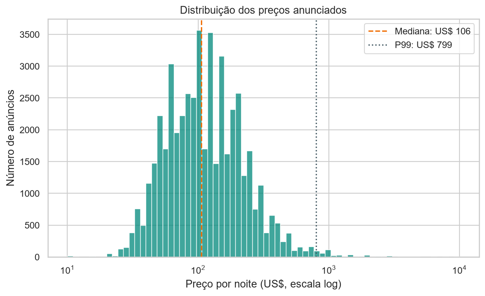
  <figcaption>A escala logarítmica permite visualizar em conjunto a concentração de preços baixos e a cauda longa à direita. A linha vertical marca a mediana; os 11 preços iguais a zero são excluídos do eixo logarítmico.</figcaption>
</figure>

A mediana do preço positivo é **US$ 106**, enquanto o percentil 95 é US$ 355 e o percentil 99 é US$ 799. A diferença entre a mediana e os percentis mais altos mostra a assimetria da variável-alvo: poucos anúncios caros podem influenciar fortemente métricas quadráticas como RMSE. O notebook trata essa cauda por um corte definido exclusivamente no treino; a figura descritiva mantém todos os preços positivos e usa escala logarítmica para facilitar a leitura.

### Preço por tipo de quarto e distrito

<figure markdown>
  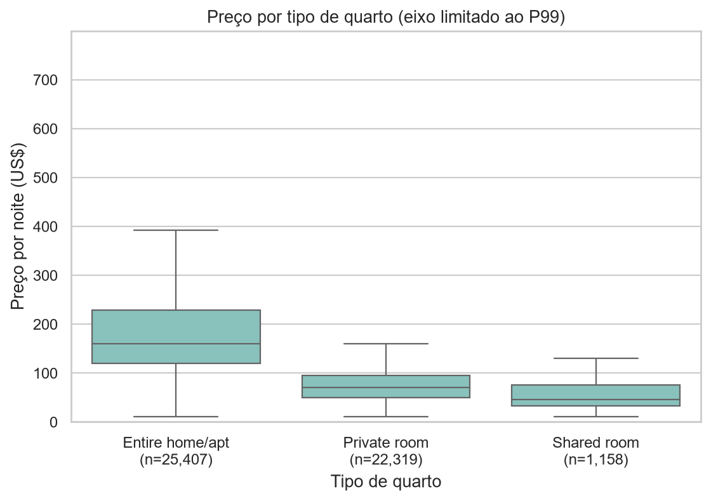
  <figcaption>A caixa representa o intervalo interquartil e a linha central, a mediana. Pontos extremos não são desenhados e o eixo é limitado ao percentil 99 apenas para facilitar a comparação.</figcaption>
</figure>

<figure markdown>
  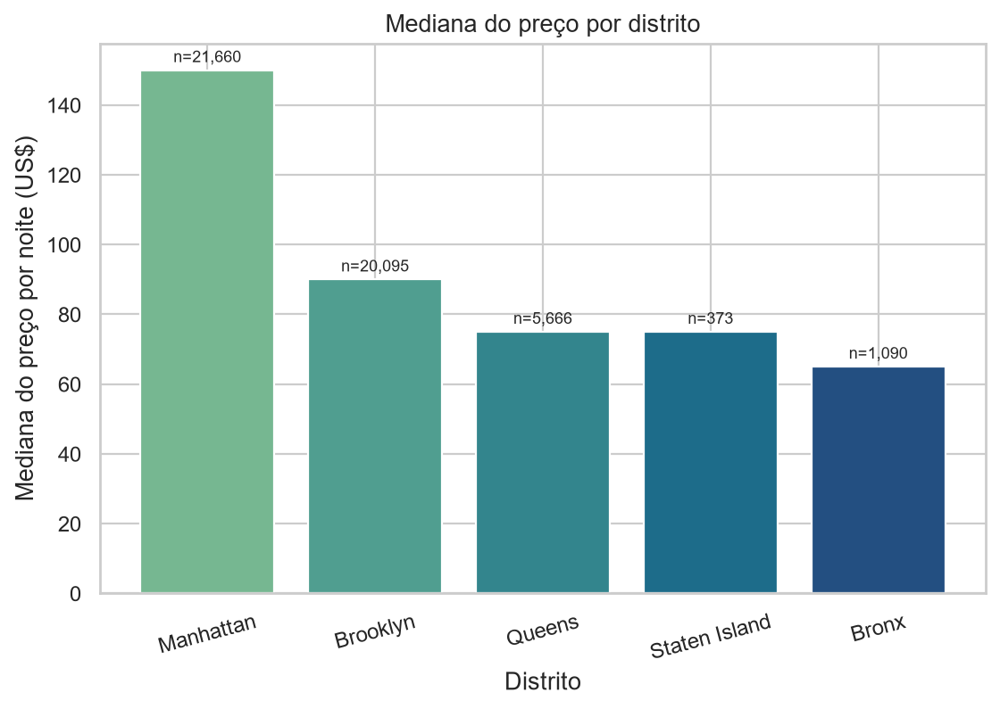
  <figcaption>Mediana dos preços positivos por distrito. O tamanho desigual das amostras deve ser considerado, em especial para Staten Island.</figcaption>
</figure>

Entre anúncios com preço positivo, as medianas são US$ 160 para `Entire home/apt`, US$ 70 para `Private room` e US$ 45 para `Shared room`. Por distrito, Manhattan tem mediana de US$ 150, acima de Brooklyn (US$ 90), Queens e Staten Island (US$ 75 cada) e Bronx (US$ 65). São associações descritivas: tipo de quarto e localização se sobrepõem, portanto essas diferenças não isolam o efeito de cada característica.

### Localização, correlações e qualidade

<figure markdown>
  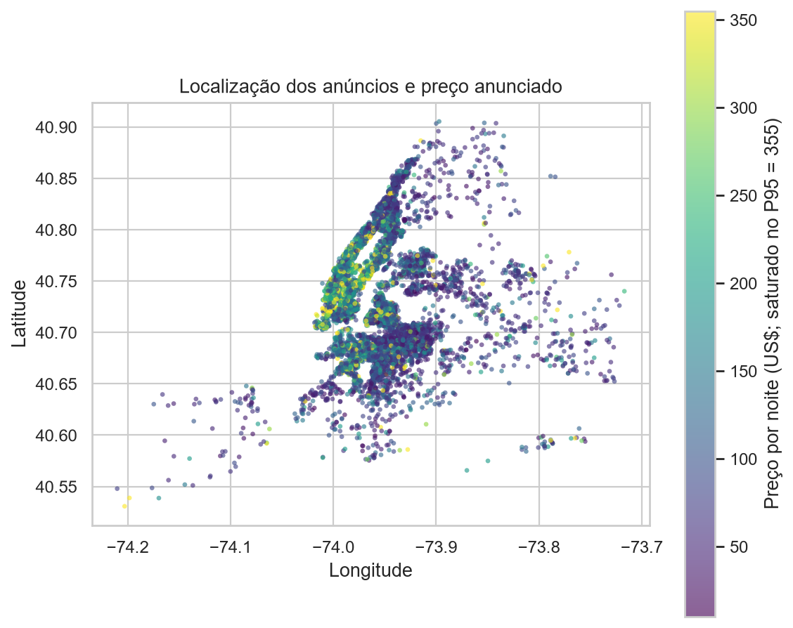
  <figcaption>Amostra reprodutível de 8.000 anúncios positivos. A escala de cor satura no percentil 95 para não deixar poucos preços altos dominarem o contraste; o gráfico não representa ruas nem limites oficiais dos bairros.</figcaption>
</figure>

<figure markdown>
  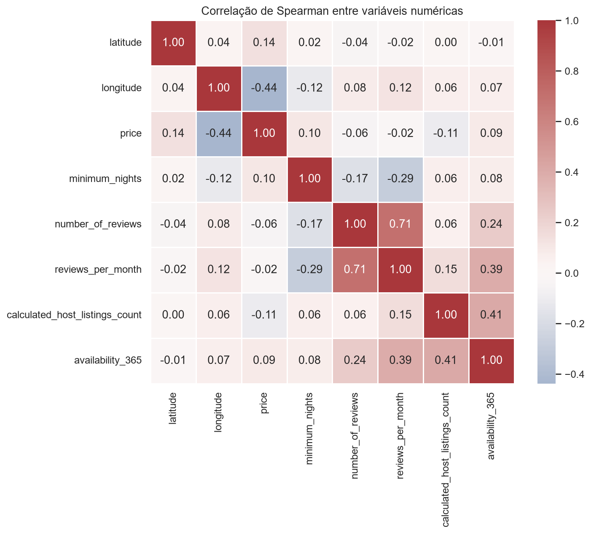
  <figcaption>Correlação de Spearman para relações monotônicas entre variáveis numéricas; não mede causalidade e pode ocultar relações não lineares ou efeitos de grupos.</figcaption>
</figure>

A correlação de Spearman entre `price` e `longitude` é aproximadamente **−0,44**, e entre preço e latitude, **0,14**. Esses valores são compatíveis com variações espaciais dentro da cidade, mas não significam que coordenadas causem diretamente o preço. Tipo de acomodação, bairro, regras de estadia e composição da amostra também podem explicar parte da associação.

<figure markdown>
  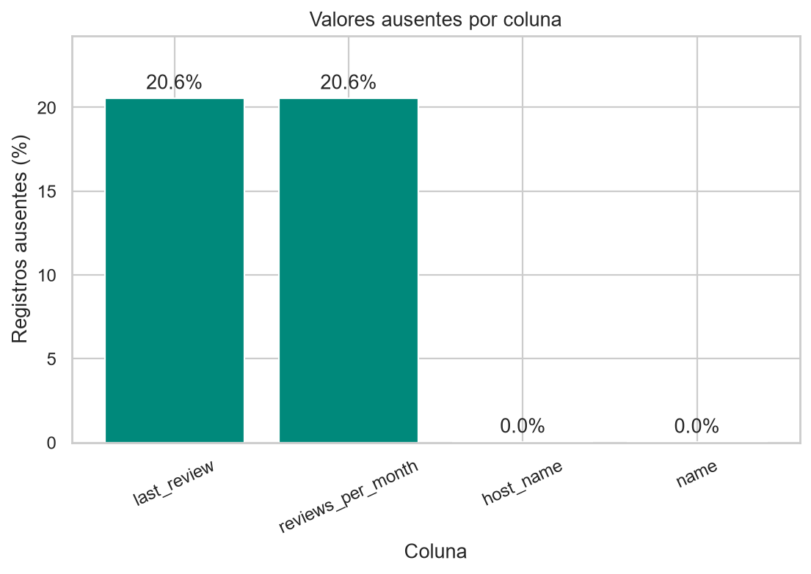
  <figcaption>Percentual calculado sobre os 48.895 registros originais. `last_review` e `reviews_per_month` têm 10.052 ausências cada; `name` e `host_name` têm poucas ausências.</figcaption>
</figure>

As 10.052 ausências em `reviews_per_month` ocorrem precisamente nos registros sem avaliações (`number_of_reviews = 0`), relação verificada no notebook. Nesse caso, imputar zero tem interpretação semântica; não é uma imputação genérica. A ausência de avaliações não implica automaticamente baixa qualidade: pode refletir anúncios novos, inativos ou pouca demanda.

!!! note "Sem ajuste com dados de teste"
    Imputação, padronização, codificação e seleção de hiperparâmetros são realizadas dentro de pipelines ajustados no treino. O conjunto de teste é reservado para a avaliação final.

## 2. Pipeline de Pré-processamento

| Grupo | Colunas | Tratamento |
|---|---|---|
| Numérica com ausência sem avaliações | `reviews_per_month` | Imputação com zero e padronização |
| Outras numéricas | `latitude`, `longitude`, `minimum_nights`, `number_of_reviews`, `calculated_host_listings_count`, `availability_365` | Imputação pela mediana e padronização |
| Categóricas | `neighbourhood_group`, `room_type`, `neighbourhood` | One-hot encoding; bairros com menos de 50 observações no treino são agrupados como infrequentes |

O processamento é encapsulado em `ColumnTransformer` e `Pipeline`, para aplicar as mesmas transformações durante a validação, o ajuste e a previsão.

## 3. Modelos e Validação

Os modelos são comparados com validação cruzada `KFold` de cinco partes, embaralhada e com semente fixa. O RMSE orienta a seleção; MAE e R² são métricas complementares.

| Modelo | RMSE médio (CV), US$ | Desvio do RMSE | MAE médio (CV), US$ | R² médio (CV) |
|---|---:|---:|---:|---:|
| Dummy (média) | 103,12 | 2,43 | 73,18 | -0,00 |
| Ridge padrão | 79,66 | 2,15 | 49,83 | 0,40 |
| HistGradientBoosting padrão | 72,88 | 1,85 | 44,44 | 0,50 |
| Ridge ajustado | 79,66 | 2,15 | 49,83 | 0,40 |
| HistGradientBoosting ajustado | **72,73** | **1,80** | 44,26 | **0,50** |

O Ridge foi ajustado por busca em grade do parâmetro `alpha`; o HistGradientBoosting, por busca aleatória de hiperparâmetros. A transformação logarítmica do alvo diminuiu o MAE médio do HistGradientBoosting para US$ 42,14, mas aumentou o RMSE para US$ 73,70. Como o critério principal é RMSE, o modelo selecionado é o HistGradientBoosting ajustado sem transformação logarítmica do alvo.

<figure markdown>
  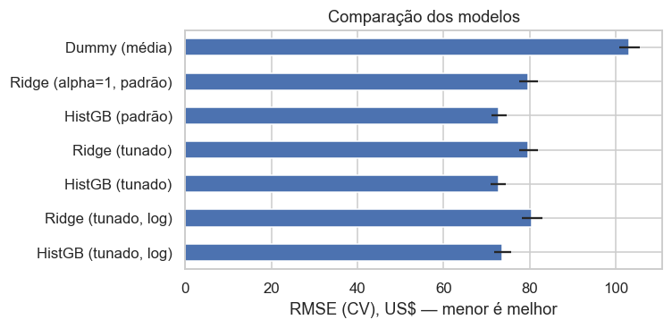
  <figcaption>RMSE médio e variação entre os folds, em dólares. Valores menores são melhores; diferenças pequenas entre modelos ajustados devem ser lidas considerando essa variação.</figcaption>
</figure>

<figure markdown>
  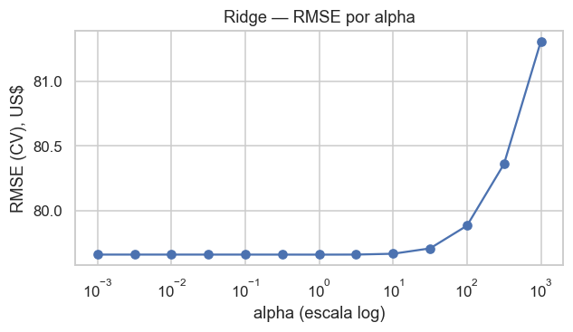
  <figcaption>A busca em grade testa regularizações de diferentes magnitudes e permite inspecionar a sensibilidade do Ridge ao parâmetro alpha.</figcaption>
</figure>

A transformação logarítmica foi uma mudança explícita no alvo testada com a mesma estratégia de validação. Ela reduziu o MAE do ensemble, mas não o RMSE, demonstrando que a métrica principal influencia a escolha do pipeline.

<figure markdown>
  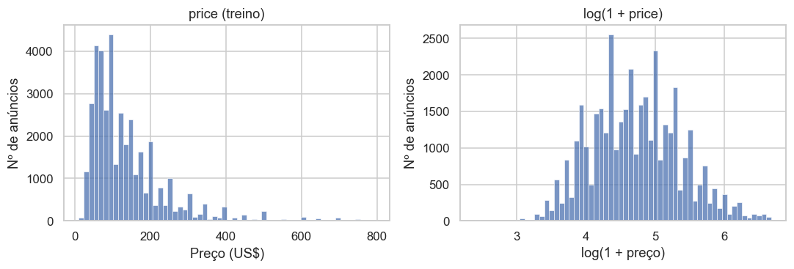
  <figcaption>A transformação comprime a cauda dos preços durante o ajuste e é invertida nas previsões para que as métricas permaneçam em dólares.</figcaption>
</figure>

## 4. Avaliação no Teste

O modelo selecionado é avaliado uma única vez no conjunto de teste reservado.

| Métrica | HistGradientBoosting ajustado | Dummy de referência |
|---|---:|---:|
| RMSE | US$ 72,77 | US$ 102,50 |
| MAE | US$ 44,35 | — |
| R² | 0,50 | — |

O modelo reduz o erro quadrático em relação à previsão constante de referência, mas ainda há variação considerável de desempenho entre faixas de preço. Portanto, a previsão pontual não deve ser interpretada como uma cotação precisa nem como garantia do preço de mercado.

<figure markdown>
  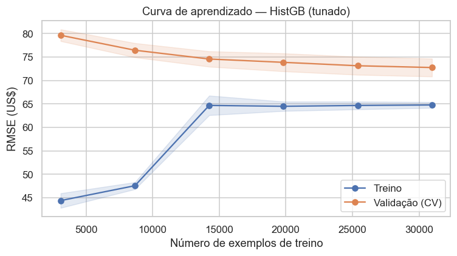
  <figcaption>Erro de treino e validação cruzada conforme aumenta o tamanho da amostra de treino. A distância entre curvas ajuda a discutir variância e o retorno de adicionar dados; os resultados dependem do split aleatório usado.</figcaption>
</figure>

<figure markdown>
  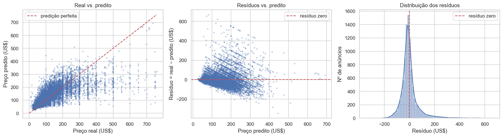
  <figcaption>O primeiro painel compara valores reais e previstos; o segundo procura padrões nos resíduos; o terceiro mostra a distribuição do erro. Resíduo é definido como preço real menos preço previsto.</figcaption>
</figure>

Os resíduos variam em escala e não se resumem ao RMSE: padrões ou espalhamento crescente no gráfico de resíduos indicariam erro condicional ao nível do preço; a distribuição permite avaliar assimetria e concentração em torno de zero. A leitura visual complementa, mas não substitui, métricas por faixa de preço e validação em dados representativos da aplicação.

!!! warning "Interpretação das métricas"
    Os resultados são calculados depois da remoção de preços acima de US$ 799, com limite definido a partir do treino. Eles não descrevem o desempenho para a cauda mais alta dos preços removidos.

## 5. Interpretação

### Importância por permutação

O notebook mede o aumento do RMSE ao embaralhar cada variável no conjunto de teste. Valores maiores indicam maior dependência do modelo daquela informação nesta avaliação.

| Variável | Aumento médio no RMSE, US$ | Desvio, US$ |
|---|---:|---:|
| `room_type` | 30,36 | 0,83 |
| `longitude` | 11,33 | 0,47 |
| `minimum_nights` | 11,26 | 0,53 |
| `availability_365` | 9,59 | 0,61 |
| `latitude` | 7,69 | 0,42 |

O tipo de quarto é a variável de maior importância por permutação, seguido por variáveis de localização e estadia. Isso descreve o comportamento do modelo e não demonstra causalidade.

<figure markdown>
  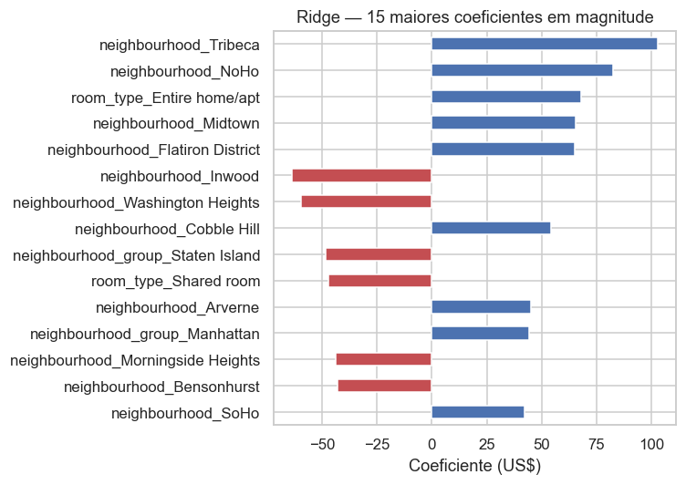
  <figcaption>Coeficientes do Ridge convertidos para a escala original do preço. Cada coeficiente é relativo às categorias de referência e às transformações do pipeline.</figcaption>
</figure>

<figure markdown>
  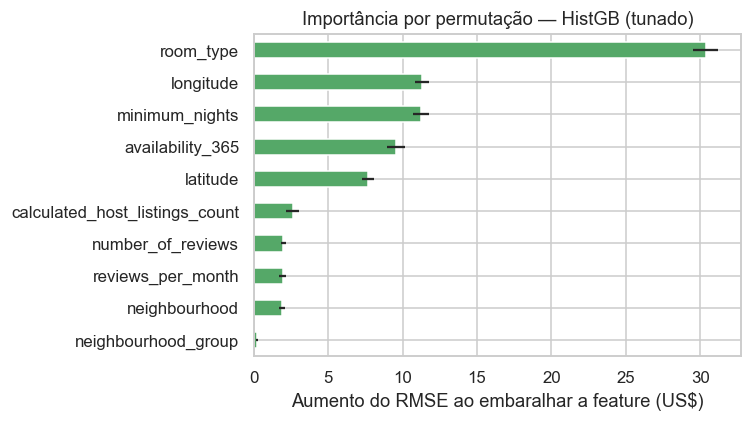
  <figcaption>Aumento médio do RMSE após permutar uma feature. Valores maiores sugerem maior contribuição preditiva nas condições avaliadas; atributos correlacionados podem compartilhar importância.</figcaption>
</figure>

O notebook também examina coeficientes do Ridge e usa SHAP para interpretar o ensemble e exemplos individuais. Essas explicações são condicionais aos dados e ao modelo ajustado; não devem ser lidas como efeitos causais de preço.

<figure markdown>
  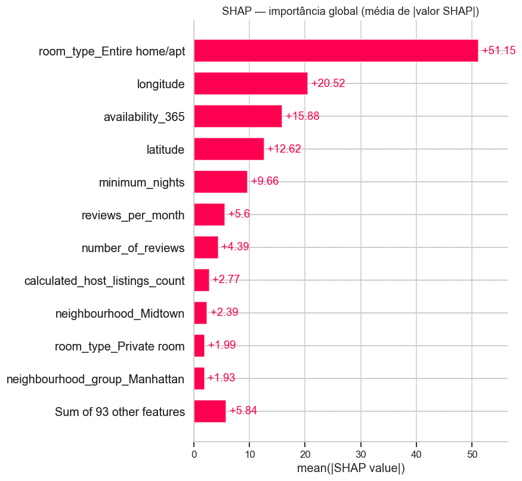
  <figcaption>Resumo global SHAP: magnitude e direção das contribuições das features na amostra explicada pelo notebook.</figcaption>
</figure>

<figure markdown>
  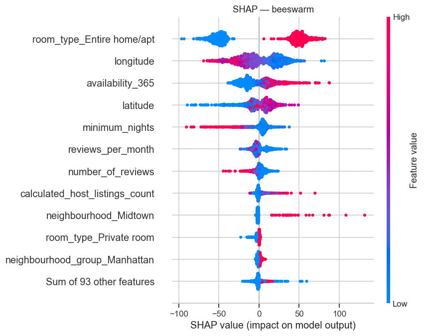
  <figcaption>Média do valor absoluto SHAP por feature. A ordenação descreve contribuição preditiva no modelo ajustado, não efeito causal no preço.</figcaption>
</figure>

### Três previsões individuais explicadas

O notebook seleciona três anúncios contrastantes (menor, mediano e maior preço predito dentro da amostra SHAP). Os gráficos mostram quais variáveis empurram cada previsão para cima ou para baixo em relação ao valor-base.

<figure markdown>
  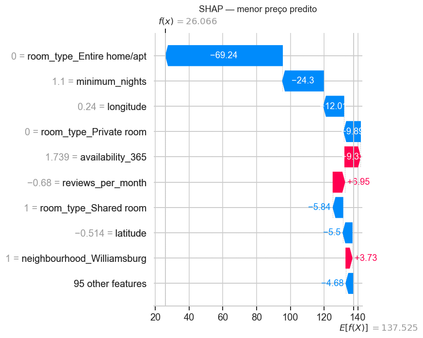
  <figcaption>Previsão mais baixa da amostra explicada; contribuições lidas em relação ao valor-base exibido no gráfico.</figcaption>
</figure>

<figure markdown>
  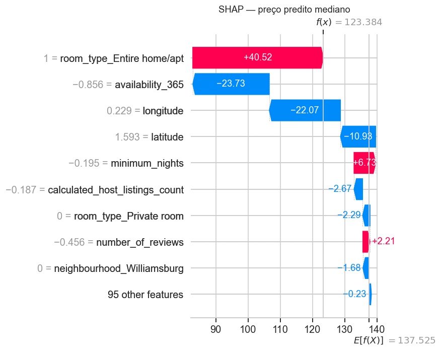
  <figcaption>Previsão mediana da amostra explicada; cada contribuição é local ao registro e ao modelo.</figcaption>
</figure>

<figure markdown>
  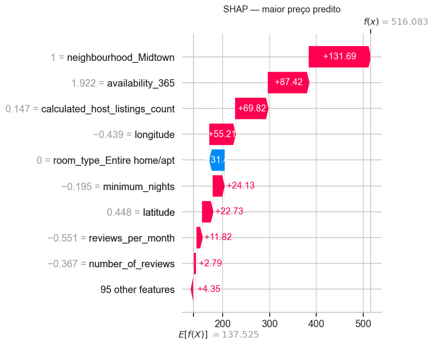
  <figcaption>Previsão mais alta da amostra explicada; não representa necessariamente o anúncio mais caro de toda a base.</figcaption>
</figure>

## 6. Limitações

### Do modelo e da validação

1. **Previsão pontual sem incerteza.** O modelo retorna um único valor, embora a escala dos resíduos varie com o preço; além disso, a cauda superior foi excluída pela regra de corte. Intervalos conformais são uma alternativa para comunicar incerteza sem assumir uma distribuição paramétrica específica para os erros (Lei et al., 2018).
2. **Validação aleatória pode ser otimista.** Anúncios próximos ou do mesmo anfitrião podem aparecer nos dois lados da divisão, facilitando a previsão de casos semelhantes. Validação agrupada por anfitrião ou região é uma avaliação complementar importante para estimar generalização espacial/hierárquica (Roberts et al., 2017).

### Dos dados

- **O alvo é preço anunciado.** `price` não confirma o valor efetivamente pago; reservas, descontos, taxas e sazonalidade não estão representados.
- **O retrato é de 2019.** A pandemia e mudanças posteriores nas regras de aluguel de curta duração em Nova York alteraram o contexto; o dataset não deve ser tratado como retrato atual sem dados recentes.

### Próximos passos

1. **Empacotar e validar o pipeline completo.** Versionar as dependências, validar esquema e faixas de entrada (por exemplo, coordenadas e `minimum_nights`), registrar categorias novas e testar o artefato antes da publicação. Testes de dados e monitoramento são práticas centrais para reduzir dívida técnica em sistemas de ML (Breck et al., 2017; Sculley et al., 2015).
2. **Monitorar e retreinar com critério.** Acompanhar a distribuição das features e, quando houver preços realizados, o erro por faixa; definir limites de alerta e comparar um candidato atualizado com o modelo vigente antes da substituição. Mudanças graduais na relação entre entradas e alvo são conhecidas como *concept drift* (Gama et al., 2014).

## Conclusão

O HistGradientBoosting melhora a referência e alcança RMSE de US$ 72,77 no teste filtrado. O resultado é informativo para comparar modelos dentro do escopo do dataset, mas as limitações temporais, espaciais e do próprio alvo impedem interpretar essa métrica como garantia de preço para anúncios atuais.
