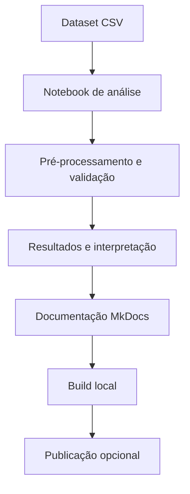

# Arquitetura do Projeto

## Estrutura de Diretórios

```text
NYCAirbnb-Regression/
├── docs/
│   ├── assets/
│   │   ├── images/
│   │   └── stylesheets/
│   │       └── extra.css
│   ├── index.md
│   ├── dataset.md
│   ├── analysis.md
│   ├── setup.md
│   ├── project-structure.md
│   └── references.md
├── AB_NYC_2019.csv
├── nycairbnb.ipynb
├── scripts/
│   └── generate_docs_figures.py
├── .github/
│   └── workflows/
│       └── deploy-docs.yml
├── mkdocs.yml
├── README.md
├── requirements.txt
└── requirements-docs.txt
```

## Componentes

- `nycairbnb.ipynb`: notebook de análise, treinamento, avaliação e interpretação dos modelos.
- `AB_NYC_2019.csv`: dataset original de anúncios de Airbnb em NYC.
- `docs/`: documentação do projeto em Markdown.
- `docs/assets/images/`: gráficos descritivos gerados a partir do CSV e gráficos exportados do notebook.
- `docs/assets/stylesheets/extra.css`: ajustes visuais do tema MkDocs Material.
- `scripts/generate_docs_figures.py`: gera figuras da análise descritiva sem modificar o notebook.
- `.github/workflows/deploy-docs.yml`: valida e publica o site no GitHub Pages a cada atualização relevante no branch `main`.
- `mkdocs.yml`: configuração, tema, extensões e navegação do site.
- `requirements.txt`: dependências para executar o notebook.
- `requirements-docs.txt`: dependências para gerar e publicar a documentação.

## Organização da Documentação

| Página | Papel na entrega |
|---|---|
| `index.md` | Apresentação do problema, métricas e principais achados. |
| `dataset.md` | Fonte, dicionário de dados, ausências e decisões de preparação. |
| `analysis.md` | Pipeline, comparação de modelos, resultados e limitações. |
| `setup.md` | Instalação, execução do notebook e comandos MkDocs. |
| `project-structure.md` | Estrutura do projeto e função de cada arquivo. |
| `references.md` | Dataset, bibliotecas e conceitos usados. |

## Fluxo de Trabalho



## Organização do Pipeline

- Separação treino/teste antes do ajuste das transformações.
- Imputação, escala e codificação encapsuladas em `Pipeline` e `ColumnTransformer`.
- Seleção de hiperparâmetros por validação cruzada no treino.
- Avaliação final no conjunto de teste reservado.

Essa separação reduz vazamento de informação durante o treinamento e deixa explícito o escopo dos resultados.
